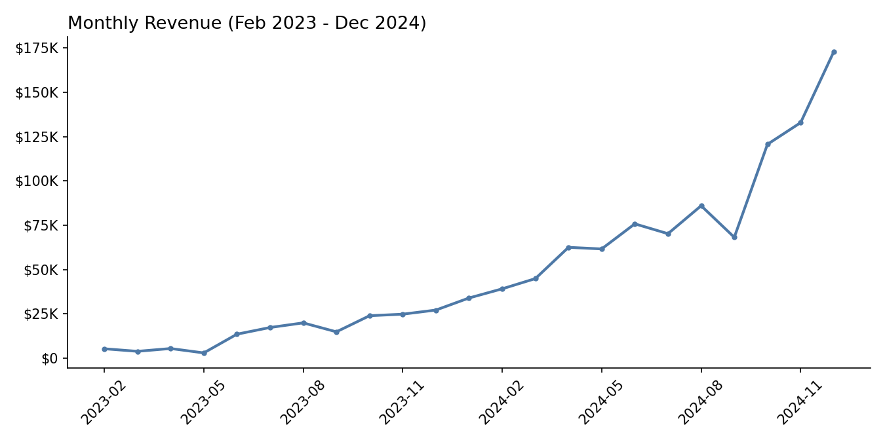
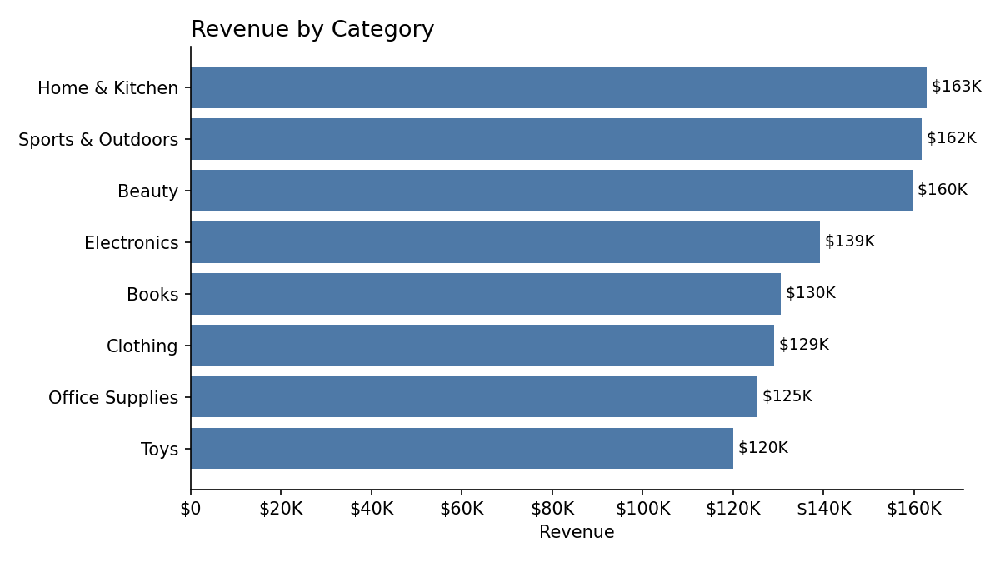
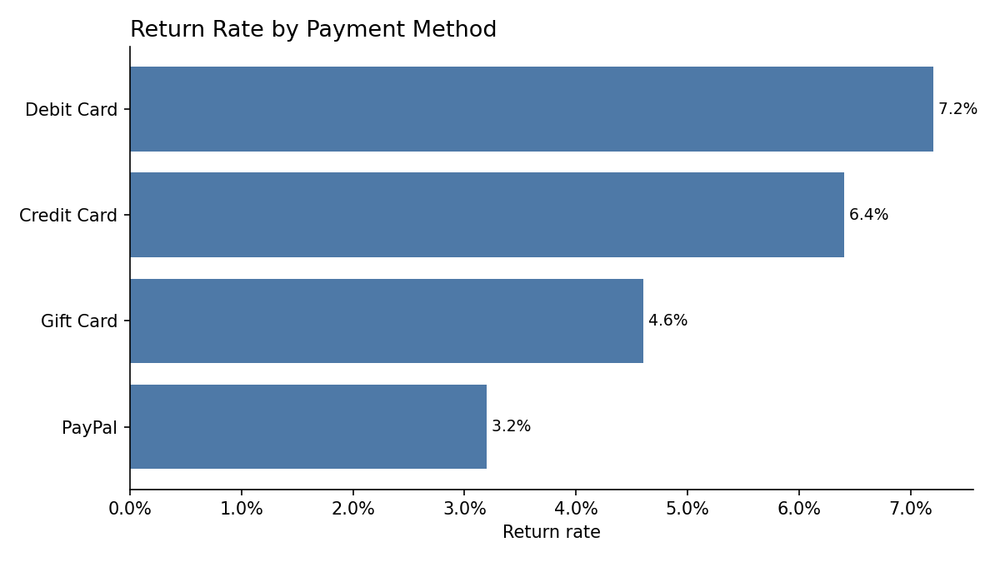
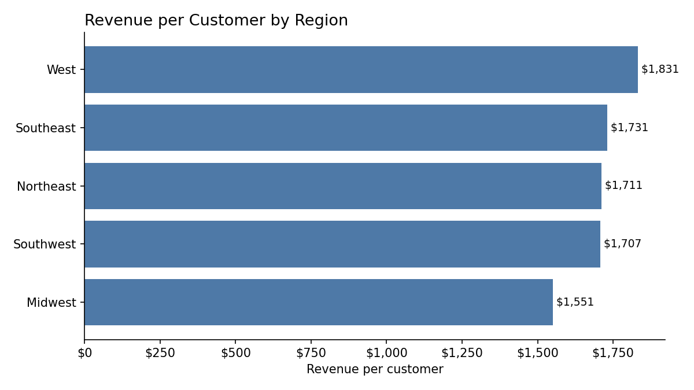

# E-Commerce Business Analysis (SQL)

A SQL analysis of an e-commerce dataset (customers, orders, products) that answers common business questions: who the best customers are, which categories drive revenue, whether revenue is growing, and where returns are concentrated.

**Tools:** SQL (SQLite) · Python (data generation, running queries, charts)

## Why this project
Entry-level analytics roles spend much of their time turning raw transactional data into answers stakeholders can act on. This project covers that workflow end to end: schema design → data generation → SQL analysis → charts → business takeaways.

---

## Dataset
Synthetic but realistic e-commerce data generated with `generate_data.py` (seeded for reproducibility) and loaded into a SQLite database, `ecommerce.db`. CSV exports of each table are included for quick viewing on GitHub. Orders run from **February 2023 to December 2024**.

| Table | Rows | Columns |
|---|---|---|
| `customers` | 800 | customer_id, first_name, last_name, region, signup_date |
| `products` | 64 | product_id, product_name, category, unit_price |
| `orders` | 1,682 | order_id, customer_id, order_date, payment_method, is_returned |
| `order_items` | 4,183 | order_item_id, order_id, product_id, quantity |

---

## Business Questions & Key Findings

All 8 queries are in [`queries.sql`](queries.sql), and their full outputs are saved in [`results/`](results).

**1. Top customers by revenue:** the top 10 customers each generated $5.7K–$7.9K in lifetime revenue across 4–10 orders, more than 3x the average customer ($1,707). A small group of frequent buyers contributes disproportionately to revenue.

**2. Month-over-month revenue growth:** revenue grew from $5.3K in February 2023 to $172.9K in December 2024. The largest single-month jump was June 2023 (+355%), and Q4 2024 (October–December) alone produced $426K, about 38% of all revenue.



**3. Revenue by category:** Home & Kitchen ($162.8K) and Sports & Outdoors ($161.6K) lead, and Toys ($120.0K) is lowest. Revenue is spread fairly evenly across all 8 categories. Beauty ranks third in revenue despite selling the fewest units, because it has the highest average price per unit ($166).



**4. Repeat purchase rate:** 439 of the 661 customers who ordered (66.4%) placed more than one order, which points to strong repeat engagement.

**5. Returns by payment method:** debit card orders were returned most often (7.2%), more than double PayPal (3.2%). The overall return rate is 5.3% (89 of 1,682 orders). Return counts are small (29 debit card returns vs. 14 PayPal), so this is a pattern worth monitoring rather than a firm conclusion.



**6. Revenue by region:** the Southwest brings in the most total revenue ($257.8K, 151 customers), but the West has the highest revenue per customer ($1,831). The Midwest has both the lowest total revenue ($195.4K) and the lowest revenue per customer ($1,551), making it a potential target for regional marketing.



**7. Signup cohort analysis:** customers who signed up in August 2023 generated the highest average revenue per customer ($1,879). Later cohorts have had less time to make purchases, so their lower figures are partly expected.

**8. Average order value and customer lifetime value:** the average order is worth $670.76, and customers place 2.54 orders on average, giving an average historical lifetime value of $1,706.83 per customer.

---

## SQL Techniques Used
- Multi-table `JOIN`s across four related tables
- Aggregations with `GROUP BY`, `COUNT(DISTINCT ...)`, `SUM`, and `ROUND`
- Common table expressions (`WITH ... AS`)
- Window functions (`LAG() OVER (ORDER BY ...)`) for month-over-month change
- Conditional aggregation (`SUM(CASE WHEN ... THEN 1 ELSE 0 END)`)
- `LEFT JOIN` to keep customers with no orders in the cohort analysis

---

## Files
```
├── generate_data.py   # builds the synthetic dataset into ecommerce.db
├── ecommerce.db       # SQLite database (generated)
├── queries.sql        # all 8 business-question queries, commented
├── run_analysis.py    # runs every query, saves results/ and images/
├── results/           # CSV output of each query
├── images/            # charts of key findings
├── customers.csv      # table exports
├── products.csv
├── orders.csv
├── order_items.csv
└── README.md
```

## How to run it yourself
```bash
python3 generate_data.py   # builds ecommerce.db (already included)
pip install matplotlib
python3 run_analysis.py    # runs all queries, writes results/ and images/
```
Or run the queries directly with `sqlite3 ecommerce.db < queries.sql`, or open `ecommerce.db` in [DB Browser for SQLite](https://sqlitebrowser.org/).

---

## Related Projects
This dataset is the foundation for two follow-up projects:
- **[PostgreSQL Database Design & Administration](https://github.com/Pdhruv1512/ecommerce-postgres-dba):** the same data migrated to PostgreSQL with constraints, indexing (27x faster lookups), role-based access, and verified backups
- **[E-Commerce Sales Dashboard](https://github.com/Pdhruv1512/ecommerce-sales-dashboard):** an interactive Tableau dashboard built on this data ([live version](https://public.tableau.com/app/profile/pdhruv15/viz/E-CommerceSalesDashboard_17924822464680/SalesDashboard))
